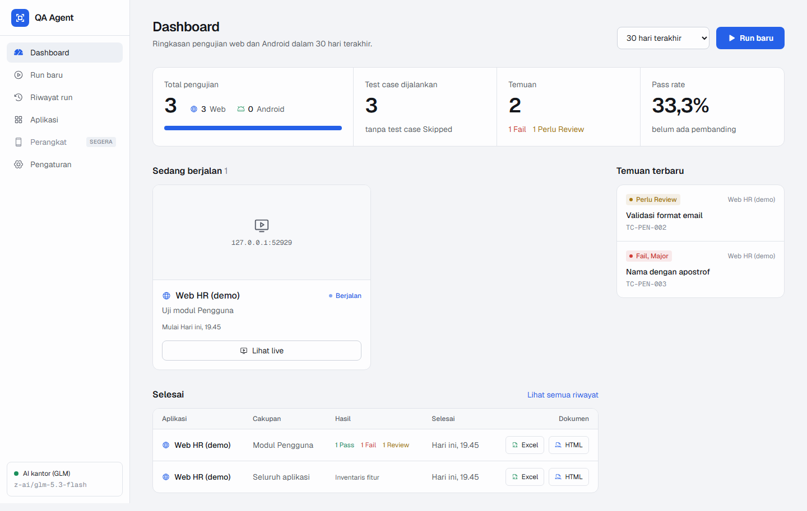

# QA Agent

AI yang berperan sebagai QA automation engineer untuk aplikasi web. Agent menjelajahi aplikasi sendiri, menyusun test case, menjalankannya di browser, lalu menghasilkan dokumen test case (Excel) dan laporan eksekusi (HTML/PDF) lengkap dengan screenshot. Pengujian bersifat black-box, tanpa akses ke kode developer. Semua bisa dijalankan dari dashboard web lokal dengan layar live dan intervensi, atau dari CLI.

## Instalasi (Windows)

1. Pasang Python 3.12: `winget install -e --id Python.Python.3.12`
2. Di folder proyek:
   ```powershell
   & "$env:LOCALAPPDATA\Programs\Python\Python312\python.exe" -m venv .venv
   .venv/Scripts/python -m pip install -e ".[dev]"
   .venv/Scripts/python -m playwright install chromium
   ```
3. `.venv/Scripts/qa-agent init`, lalu salin `.env.example` menjadi `.env` dan isi:
   - `OFFICE_AI_KEY`: API key AI kantor
   - `QA_ADMIN_USER` / `QA_ADMIN_PASS`: akun **test** aplikasi yang dites
4. Sesuaikan `target.url` di `qa-agent.yaml`, lalu jalankan `.venv/Scripts/qa-agent check`. Semua baris harus `[OK]`.

## Dashboard (cara utama)



```powershell
.venv/Scripts/qa-agent serve
```

Browser terbuka otomatis di `http://127.0.0.1:8787`. Bila port itu terpakai, port kosong berikutnya dipakai dan alamatnya ditampilkan. Opsi: `--no-browser`, `--port`, `--max-parallel 2`, `--data-dir`.

1. **Pengaturan > Model AI:** isi base URL endpoint (AI kantor, OpenAI GPT, Ollama, dan lain-lain) atau pilih Anthropic, API key, dan model. Pakai **Ambil daftar model** dan **Tes koneksi** (teks dan gambar).
2. **Aplikasi:** tambahkan URL, domain yang boleh dibuka, dan akun test.
3. **Run baru:** pilih **Seluruh aplikasi** untuk memetakan modul, lalu **Satu modul** untuk uji mendalam. PRD `.md`/`.txt` bersifat opsional. Aktifkan **Konfirmasi tiap langkah** bila ingin menyetujui setiap langkah agent.
4. **Layar live:** tampilan browser yang sedang dites, dengan kotak elemen yang sedang dikerjakan AI. Intervensi yang tersedia:

   | Tombol | Fungsi |
   |---|---|
   | Jeda / Lanjutkan | Menahan run di titik aman berikutnya, lalu melanjutkannya |
   | Ambil alih | Klik, ketik, tekan tombol, dan scroll langsung dari layar live. **Kembalikan ke AI** meneruskan catatan langkahmu ke AI. **Akhiri: Pass/Fail** menetapkan hasil test case. |
   | Arahkan agent | Arahan teks yang dipakai AI sampai test case selesai |
   | Pikir ulang | Saat dijeda: rencana langkah dibuang, AI memilih ulang |
   | Lewati | Test case menjadi Blocked, dengan catatan "Dilewati oleh QA" |
   | Hentikan | Berhenti rapi. Laporan parsial ditulis dan run bisa dilanjutkan. |

   Semua intervensi tercatat di laporan sebagai langkah manual atau arahan QA.
5. **Hasil run:** filter temuan, isi Status Final, Severity, dan Catatan reviewer. Unduh Excel, HTML, atau PDF, atau salin temuan sebagai laporan bug (Jira).

**Data & keamanan**
- Folder data default `%USERPROFILE%\QA Agent\`, berisi `qa-agent.db` (indeks), `runs/` (evidence dan laporan), dan `auth/` (sesi login).
- API key dan password akun test disimpan di **Windows Credential Manager**, tidak pernah ditulis ke file, log, laporan, atau dikirim ke AI. Dashboard hanya menampilkan versi tersamar (`sk-••••3f9a`).
- Server hanya mendengarkan `127.0.0.1`, jadi tidak bisa diakses dari laptop lain.
- Server mati di tengah run? Run ditandai **Terhenti** dan bisa dilanjutkan dari layar run.
- **Impor run lama:** di halaman Aplikasi, isi folder `runs/` hasil CLI supaya masuk Riwayat dan Dashboard.

**Build frontend** (sekali, atau setiap kali kode `web/` berubah; butuh Node 20+):
```powershell
npm --prefix web install
npm --prefix web run build
```

## Android

QA Agent menguji aplikasi Android di **HP sungguhan lewat kabel USB**, atau di emulator yang sedang berjalan, memakai `adb`. Tidak ada aplikasi pembantu yang dipasang di HP.

1. **Pasang adb** (sekali): unduh *SDK Platform-Tools for Windows* dari developer.android.com, lalu ekstrak sehingga ada `%USERPROFILE%\QA Agent\platform-tools\adb.exe`. QA Agent menemukannya otomatis. adb di PATH atau di Android SDK juga terdeteksi.
2. **Siapkan HP:** Setelan → Tentang ponsel → ketuk *Nomor bentukan* 7 kali → Opsi pengembang → aktifkan **Debugging USB**. Sambungkan kabel, lalu ketuk **Izinkan** di HP. Cek di menu **Perangkat**.
3. **Run baru → Android:** pilih perangkat, lalu pilih aplikasi yang sudah terpasang atau **Upload APK** (dipasang otomatis). Alurnya sama dengan web: Seluruh aplikasi dulu, lalu Satu modul.

Catatan:
- Layar live memakai screenshot beruntun (sekitar 1–3 fps). Ambil alih mendukung tap, ketik, tombol (Enter/Back), dan swipe.
- Crash aplikasi dan dialog "tidak merespons" / "telah berhenti" otomatis menjadi bukti Fail.
- Explore mencatat urutan tap ke setiap layar, sehingga run modul bisa langsung membuka layar awal test case.
- Mode production di Android hanya memblok aksi berisiko berdasarkan nama tombol. Request jaringan aplikasi tidak bisa dicegat, jadi tetap pakai akun dan data uji.
- Keterbatasan: mengetik huruf non-ASCII (mis. é) belum didukung, menyalakan emulator dari dashboard belum ada, dan WebView diuji seadanya.

## Server tim (login & peran)

Untuk dipakai bersama tim, jalankan QA Agent di server dengan Docker + HTTPS. Langkah lengkapnya ada di [docs/deploy.md](docs/deploy.md). Ringkasnya:

- **Login wajib** di mode server. Ada tiga peran: Admin, QA, dan Viewer.
- **Admin pertama** dibuat dengan `qa-agent user add <nama> --role admin`. Pengguna berikutnya dikelola Admin dari **Pengaturan > Keamanan**.
- **Rahasia** (API key AI, password akun test) disimpan terenkripsi dengan kunci induk `QA_AGENT_MASTER_KEY` (`qa-agent secret-key`).
- **HP Android** bisa dicolok USB ke server, atau disambungkan lewat **Perangkat > Sambungkan lewat jaringan** (Wireless debugging).

## Alur kerja CLI

1. **Petakan aplikasi:** `qa-agent explore`
   Hasilnya ada di `runs/<tanggal>_explore_<host>/`: sheet *Inventaris Fitur* dan daftar modul.
2. **Tes satu modul:** `qa-agent deep --from runs/<folder-explore> --module "Pengguna" [--prd prd_pengguna.md]`
   - Tambahkan `--review` untuk mengecek atau mengedit `testcases.xlsx` dulu, lalu jalankan `qa-agent run --run runs/<folder-deep>`.
3. **Review hasil:** buka `report.xlsx`, cek baris **Perlu Review**, lalu isi kolom **Status Final** dan **Catatan Reviewer**.
4. **Finalisasi:** `qa-agent report --run runs/<folder-deep>` membuat ulang Excel dan HTML dengan status final. Bagikan folder run dalam bentuk zip, atau cukup `report.html` saja.

## Status

| Status | Arti |
|---|---|
| Pass | Hasil sesuai expected |
| Fail | Ada bukti jelas: HTTP 5xx / error JavaScript, atau bertentangan dengan expected dari PRD |
| Perlu Review | Tidak sesuai expected hasil inferensi AI. Kamu yang memutuskan. |
| Blocked | Tidak bisa dieksekusi (elemen tidak ditemukan, loop, timeout, batas langkah) |
| Skipped | Diblok Safety Guard (mode production) |

## Mode production

`--env production` memblok aksi berisiko (hapus, simpan, kirim, bayar, dan sejenisnya) **dan** membatalkan semua request POST/PUT/PATCH/DELETE. Pengecualiannya hanya endpoint login, dan itu pun **hanya selama agent sedang login**. Service Worker juga diblok supaya request tidak bisa lewat jalur lain.

- Jika endpoint login aplikasi tidak mengandung login/auth/signin/token/session, isi `target.login_endpoints` (dicocokkan per path, misalnya `/api/v2/masuk`).
- Aplikasi yang memakai POST untuk membaca data (GraphQL, pencarian via POST) atau WebSocket tidak cocok dites di mode ini.
- Gunakan mode production hanya jika benar-benar perlu.

## Jika ada masalah

- **AI kantor mati di tengah run:** status run menjadi `paused`. Di dashboard klik **Coba lagi**; di CLI jalankan `qa-agent run --run <folder> --resume`.
- **Review dari dashboard saat `report.xlsx` terbuka di Excel:** review tetap tersimpan, dan dashboard memberi peringatan. Tutup Excel lalu simpan review lagi untuk memperbarui file.
- **Ctrl+C:** tekan sekali untuk berhenti dengan rapi (laporan parsial tetap ditulis), dua kali untuk keluar paksa.
- **"Tutup file itu di Excel":** tutup `report.xlsx` lalu jalankan `qa-agent report --run <folder>`.
- **Ganti model:** ubah `llm.model` di config. Untuk Claude: `provider: anthropic`, `model: claude-sonnet-5-5`, `api_key_env: ANTHROPIC_API_KEY`.

## Keterbatasan

Web dan Android (lihat bagian Android untuk batasannya). Untuk web belum mendukung OTP/2FA/CAPTCHA, login yang disimpan di sessionStorage (agent akan login ulang tiap test case), elemen canvas, shadow DOM tertutup, iframe lintas domain, PRD selain `.md`/`.txt`, maupun template Excel kustom. Screenshot di laporan bisa berisi data aplikasi (termasuk password, jika AI menekan tombol "lihat password"), jadi perlakukan laporan sebagai dokumen internal.

## Pengembangan

- Test: `.venv/Scripts/python -m pytest` (otomatis menjalankan aplikasi demo + Chromium headless; test E2E dashboard butuh frontend yang sudah di-build)
- Test frontend: `npm --prefix web run test`
- Aplikasi demo manual: `.venv/Scripts/python -m tests.demo_app` → http://127.0.0.1:5055
- Dashboard demo dengan AI palsu (tanpa endpoint AI): `.venv/Scripts/python -m tests.e2e.harness`
- Dev frontend dengan hot reload: jalankan `qa-agent serve --no-browser`, lalu `npm --prefix web run dev` (http://127.0.0.1:5173, `/api` dan `/ws` diteruskan ke port 8787)
- Screenshot halaman nyata: `.venv/Scripts/python -m tests.e2e.screens` → `docs/design/screens/`
- Tailwind: daftar kelas dibuat oleh `web/tw-candidates.ts`, karena binary native Tailwind diblokir antivirus di laptop kantor.
